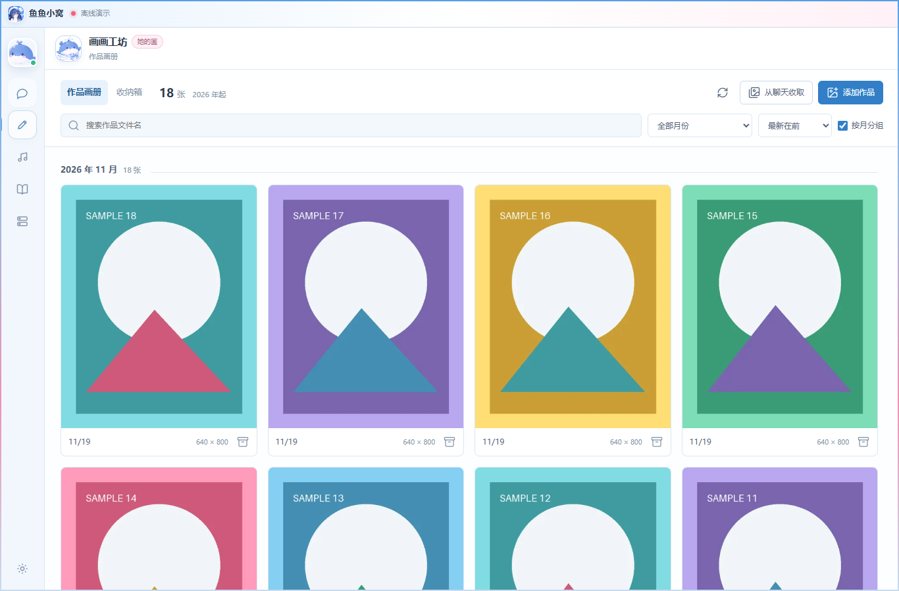

# 鱼鱼小窝

**给你和你的 AI 搭子，一个聊天之外的小窝。**

也许你已经有一个常聊的 Agent。它给你画过一张舍不得删的图，你们有首常听的歌，它偶尔还会写两句日记。鱼鱼小窝就是放这些东西的地方：聊完天，画可以收进画册，歌可以接着放，日记按日期慢慢攒。第一次打开，投喂栏里给你留了一碗白米饭。

小窝在你的电脑上运行，不自带模型或角色。你可以先离线逛一圈，再接自己的 Agent、本地生图和语音服务。头像、昵称和签名由你定；聊天、图片和音频存在哪儿，也由你选。



**第一次来？** Windows 装好 Python 3.10 或更新版本后，下载并解压源码，双击 `打开鱼鱼小窝.cmd`。选一个数据目录就好，里面的文件夹由小窝创建。想接自己的 Agent，再看[可选连接](#可选连接)。

## 启动

需要 Python 3.10 或更新版本。浏览器模式只依赖 Pillow。

Windows 可双击 `打开鱼鱼小窝.cmd` 打开桌面窗口。启动器会准备独立的运行环境，首次启动可接受默认数据目录或另选位置。桌面组件安装失败或 WebView2 不可用时，可在提示里选择用浏览器继续。也可以在终端运行 `.\打开鱼鱼小窝.cmd --browser` 直接打开同一份资料。需要合成消息和样图时，请用独立数据目录运行 `--demo`。

```sh
python -m venv .venv
```

在 Windows 激活环境：

```powershell
.\.venv\Scripts\Activate.ps1
```

在 Linux 或 macOS 激活环境：

```sh
. .venv/bin/activate
```

然后运行：

```sh
python -m pip install -r requirements.txt
python -B panel/panel.py --demo
```

启动时自动打开浏览器，并打印本机访问地址。端口默认自动分配；也可以指定 `--port 8610`。`--no-browser` 只启动服务。

可选桌面窗口：

```sh
python -m pip install -r panel/requirements-desktop.txt
python -B panel/panel.py --demo --desktop
```

Windows 桌面模式使用 WebView2。点窗口右上角的叉会收进系统托盘，点托盘图标可找回窗口，右键选择「退出小窝」会结束面板。浏览器模式在终端按 Ctrl+C 结束。

## 数据与配置

源代码目录只放代码。默认数据位置：

- Windows：`%LOCALAPPDATA%\QQPanel\<模式>`
- macOS：用户目录下的 `Library/Application Support/QQPanel/<模式>`
- Linux：`$XDG_DATA_HOME/qq-panel/<模式>`，未设置时使用用户目录下的 `.local/share`

聊天、媒体、数据库、主题和素材都写入同一个可配置数据目录。演示和实际连接默认分开存放。可以通过命令行、`QQ_PANEL_DATA_DIR` 环境变量或配置中的 `data_dir` 指定目录，优先级按此前后顺序：

```sh
python -B panel/panel.py --demo --data-dir ./data/demo
```

Windows 双击首次启动默认选用 `%LOCALAPPDATA%\QQPanel\home`。选好一个目录即可，程序按需建立聊天、图片、音频等子目录。以后可以在控制台打开该目录。迁移前请退出小窝并备份整个目录，图片和音频的索引也在里面。

复制 `panel/config.example.json` 为不提交的 `panel/config.json`，也可用 `--config` 指向其他 JSON 文件。默认模式为 `demo`，所有外部适配器关闭，密钥为空。服务地址、超时和密钥环境变量名都在示例配置中。

媒体以内容哈希去重，消息只引用媒体 ID。聊天附件保留原件，其它静态图片按设置生成归档版本，缩略图单独生成，动图保留原格式。画册一次加载 12 张小图，预览时才读取清晰版本；游标绑定筛选和内容版本，刷新期间新增作品会提示更新。收纳只改变画册集合，不删除聊天引用。

媒体设置默认临时保留 30 天、回收站宽限 7 天，缩略图继续保留。永久作品不参与自动过期。修改保留期不会立即清空文件；彻底删除需要在媒体管理中明确操作。新目录可直接运行，不会搜寻或导入其他软件的数据。

## 生活页

左侧可以直接在聊天、画册、唱歌房、日记和控制台之间切换。切换时保留同一窗口中的聊天草稿、日记草稿和浏览位置，播放中的歌曲不会停。

- 日记按日期浏览和编辑。点日期旁的「加照片」可选本机图片，也可以让自己的 Agent 写入数据目录的 `diary/YYYY-MM-DD.md` 和 `diary/photos/YYYY-MM-DD-名称.png`。支持 PNG、JPEG、GIF 和 WebP，每天最多展示 24 张，每张 10 MiB 以内。面板按日期自动读取 UTF-8 正文和配图。外部程序更新已有正文时建议先写临时文件再替换。
- 少数试用目录中的 `diary/entries.sqlite3` 按日期只读兼容；同一天写了新文件后以 `.md` 为准，不改旧库。备份时先退出面板，再备份整个数据目录。
- 唱歌房的「导入歌曲」支持播放器能读的 MP3、WAV、M4A、OGG、FLAC 和 Opus，单首最多 32 MiB。原件保存在数据目录 `songs/imported/`，同名自动编号，歌单即时更新。手工管理的 `songs/playlist.json` 仍能为 `songs/` 中的歌曲设置曲名、制作信息和歌词路径。
- 「开一个新鱼塘」确认后只在本机分段，旧消息仍可翻阅及搜索。不修改连接端的会话或记忆，也不会重发消息。

## 客户端核心与连接器

小窝的三栏聊天界面与后端连接分开维护：

- `panel/core/`：统一消息、事件、端点、资料和连接状态模型，以及可恢复的投递、去重、游标索引。OneBot 不是内部消息格式；图片与语音以媒体 ID 归档。
- `panel/connectors/`：演示、本地 OneBot、DSH 本地和 DSH 远程连接器。连接器负责协议转换、能力协商、心跳、续接和事件去重。
- 点击自己或对方的头像，可以分别换头像、昵称和签名。在小窝设置的外观优先显示。恢复默认后使用连接端提供的资料，其次才使用内置头像和称呼。
- `panel/panel.py`：保留历史分页、媒体归档和现有界面 API 的兼容层，便于之后迁移个人版。

内部消息至少包含 `conversation_id`、`message_id`、`event_id`、`sequence`、`sender`、`created_at`、
`delivery_status`、`segments`、`attachments`、`capabilities` 和 `protocol_version`。媒体正文归档后只
引用媒体 ID，不把大段 base64 写入聊天记录。

## 可选连接

双击启动后，在控制台「聊天连接」填写本项目 `dsh-client/1` 网关的地址和令牌，可以先测试再保存。本机网关支持回环 HTTP，远程网关使用验证证书的 HTTPS。原生 DSH 通过下述网关接入。「桥接控制台」可以登记已有管理入口。「今天的账单」在没有数据源时显示未接入。

「服务」可接已经在本机运行的 ComfyUI 和 HTTP 语音服务。ComfyUI 试画使用服务返回的首个已装检查点，出图后点「存入画册」才会收藏。语音服务应提供 `GET /health` 和 `POST /tts/audio`，试听需要它返回 WAV 或 MP3。用户通过图形界面保存的连接设置位于数据目录 `connections.local.json`，请随个人资料一同保管。

### 手机聊天

在控制台的「聊天连接」点「开启手机入口」。端口留空时由系统分配，也可以填写转发使用的固定端口。用自有 SSH 隧道或 USB 转发，将手机的回环端口映射到桌面所显示的回环端口。手机浏览器打开 `http://127.0.0.1:手机侧端口/`，输入桌面显示的配对码。手机浏览器访问的地址需要使用 `127.0.0.1` 或 `localhost`。

配对码有效期五分钟，只能使用一次。「重新配对」立即收回旧访问权，「关闭手机入口」会停止监听。每次打开小窝时手机入口默认关闭。配对后可查看同一份聊天记录、浏览图片和播放语音，也能编辑文字和图片草稿后发送。桌面的头像修改会同步到手机。手机端口只开放聊天和已配对的聊天附件，画册、日记和控制台仍通过桌面查看。

### OneBot 本地端

`server/` 保留本仓库原来的 OneBot v11 本地服务。它把面板输入转换为私聊事件，供机器人框架接收，再把框架回复送回面板；不需要安装 QQ。这个适配器使用该服务的 `__inject`、`__state` 和 `/say` 接口，不能直接替代所有 OneBot 实现。

需要 Node.js 22 或更新版本。将 `server/config.example.json` 复制为 `server/config.json`。在面板配置中设置：

```json
{
  "mode": "onebot",
  "port": 8610,
  "onebot": {
    "enabled": true,
    "base_url": "http://127.0.0.1:3000",
    "token": ""
  }
}
```

依次启动面板和本地端：

```sh
python -B panel/panel.py --config panel/config.json
node server/onebot-local.mjs
```

机器人框架连接示例配置中的 HTTP 与 WebSocket 地址。面板固定端口须与服务端的 `windowUrl` 一致。两边启用鉴权时使用同一个令牌，推荐通过 `ONEBOT_TOKEN` 提供。本地端也支持 `--config`、`--data-dir` 和 `ONEBOT_DATA_DIR`，媒体默认写入用户数据目录。

协议动作与限制见 [协议文档](docs/协议.md)。现有命令行客户端和自检工具保留在 `tools/`。

### 模型

设置 `mode` 为 `model`，开启 `model.enabled`，填写兼容聊天补全接口的 `base_url` 与 `model` 名称。密钥可通过示例中的 `MODEL_API_KEY` 环境变量提供。当前适配器只发送文字，每次请求包含当前输入，不附带其他软件的历史或角色设定；状态会标记为 `degraded`，只适合作为演示/测试适配器。

### DSH 本地与远程接口

配置中的 `dsh_local` 和 `dsh_remote` 连接的是**本项目的网关协议**，不能填写原生 DSH 地址直接使用。
`server/gateway.py` 将统一消息转换到独立 OneBot 假端，由 qqbridge 或其他框架交给 DSH。
网关只负责运输消息，DSH 继续负责角色、记忆、工具和主动行为。

网关入口为 `python -B server/gateway.py --config <配置文件>`。复制
`server/gateway.config.example.json` 到源码目录外，填写持久绝对 `data_dir`、独立 `token`、
`onebot_url` 和固定回环 `port`，与假端使用相同令牌。假端 `windowUrl` 指向该网关的 `/say`。
qqbridge 连接假端 HTTP/WS，客户端 `dsh_local.base_url` 连接网关，不直接连接原生 DSH。
远程 TLS 可另加 `tls_port`、`cert_file`、`key_file`；监听仍为回环，由 SSH 转发访问。
升级只替换代码，配置、网关数据、假端数据和证书分开保存，保留两个数据目录才能保留端点身份。

当前实现 HTTP(S) 轮询。远程要求 HTTPS；显式设置 `allow_insecure_local` 只允许回环 HTTP 测试。
没有实现 WebSocket/WSS 传输，不声明这项能力。客户端启动时运行接收、心跳、重连，
与打开资料或查询状态无关。`ca_file` 可指定该客户端独立信任的 CA，始终验证证书及主机名。

发送前保存稳定身份和 `saved` 记录；网络调用前记为 `unknown`，回执丢失沿用此状态。
`gateway_accepted` 表示网关已持久保存，`framework_waiting` 表示假端等待框架连接，
`framework_unknown` 表示已尝试写入框架连接，尚无应用层处理确认。这些状态均不表示 DSH 已读或已送达。
运行时会更新已排队消息的状态；重试使用原身份，端点没有声明幂等能力时禁止盲目重发。
OneBot v11 事件没有应用层确认，已经尝试写入 socket 的事件不会在重连时自动重放，以免重复触发模型。
接收先归档媒体、保存消息，再提交索引和网络确认，最后持久化接收游标；发送不会推进此游标。
SQLite 索引可以从现有 JSONL 重建，旧历史和分页保持兼容。
投递状态由独立后台任务每次查询一条，按上次查询时间轮流检查并节流；没有应用层确认时，
`framework_unknown` 保留为“处理未知”，不再反复查询。状态请求不会占用正常收发的锁。

如果服务器重装或数据目录变化，网关的持久身份会改变。客户端暂停收发并显示“需重新绑定”。
打开「控制台 → 聊天连接」，核对变更后点“重新绑定此网关”。历史保留，新旧网关使用独立
接收游标；旧端点待发消息禁止转投新端点。重启或升级必须继续使用原来的网关和假端数据目录。

图片、语音均上传到网关后转换成远端自己的媒体 ID；接收时校验下载内容并映射为本地媒体 ID。
临时下载引用过期后重新获取，远端不需要读取客户端磁盘。图片默认上限 10 MiB，语音默认 20 MiB。
客户端、网关和假端均可用 `media_limits: {"image": 10485760, "record": 20971520}` 配置整数字节数，
每种最多 50 MiB。界面读取实际有效发送上限，不压缩或截断附件；新的聊天媒体保留原件，预览仍使用独立缩略图。
网关握手公布容量，发送采用各端较小的限制；旧网关未公布时按 512 KiB 兼容，旧假端按 2 MiB 兼容。
接收下载按网关公布的单媒体上限限制读取，并校验内容哈希。
请求体上限包含 base64 膨胀及 1 MiB 的文字和身份封套；多附件总量超过请求体上限也会被明确拒绝。
网关明确拒绝的回调会持久保留原身份、原始内容与原因，
不会阻塞后续消息，也不会自动重试。假端的鉴权接口 `GET /__callbacks` 提供安全摘要；
排除原因后可用 `POST /__callbacks/retry` 携带原 `event_id` 明确重试。临时网络故障仍沿原身份退避重试，
只有校验通过的持久化回执才移除回调；重试不会重新触发模型。
配置和接口细节见 [协议文档](docs/协议.md)。所有示例凭据为空，不提供公网部署或生产迁移。

### ComfyUI

开启 `comfyui.enabled` 后，可通过面板的 `comfy_submit` 接口提交 API 格式工作流，再通过 `comfy_collect` 收取结果；已归档的作品不依赖生成服务继续运行。演示模式始终拒绝外部生成请求。当前不内置模型、工作流或启动生成服务的系统脚本。

## 验证

```sh
python -B tests/run.py
python -B tools/scan_private.py
python -B tools/scan_private.py --history
```

完整浏览器回归还需 Node.js、Edge 或 Chromium：

```sh
npm ci
python -B tests/run.py --browser
```

使用 `BROWSER_EXECUTABLE` 指定浏览器可执行文件，或 `BROWSER_CHANNEL` 指定已安装的浏览器渠道。没有浏览器依赖时明确失败，不把未执行项算作通过。

有上一版源码时，可运行 `python -B tests/upgrade_check.py <上一版源码目录>`。脚本用同一个临时资料目录依次启动新版、旧版、再启动新版，核对聊天文字、图片、语音和日记文件。

测试只使用临时目录、新数据库和合成图片/音频；包括内存故障夹具、真实 HTTP 三进程来回、
独立 CA 的 HTTPS 及主机名拒绝验证、媒体传输、重启恢复、回执丢失、保存和确认失败、受限能力。
原媒体生命周期、32 路并发去重、画册分页/收纳/导出回归仍在本机运行。
真实 DSH/qqbridge 验证需要单独的 `DSH_HOME`、合成角色、独立会话和非生产模型凭据。
模拟框架回归通过只证明运输链路，不能替代真实模型回复、主动行为或生产切换验收。
截图与导出位于临时测试目录，可用 `PANEL_TEST_SCREENSHOTS` 留存验收截图。最小启动检查：

```sh
python -B panel/panel.py --demo --smoke-test --data-dir ./data/smoke
```

## 目录

- `panel/`：面板、配置、客户端核心、连接器、资料和通用媒体归档
- `panel/core/`：统一消息/事件/端点/状态模型与事件去重
- `panel/connectors/`：演示、OneBot、本地 DSH、远程 DSH 连接器
- `panel/profiles.py`：我的资料、对方资料和安全字段合并
- `panel/web/`：界面、应用图标、两张默认头像、白米饭和画册脚本
- `server/`：可选 OneBot 本地服务
- `tests/`：迁入的回归测试和独立启动验收
- `tools/`：自检、命令行客户端和仅输出位置的脱敏扫描工具
- `docs/`：接口说明、[双版维护对照](docs/双版维护.md)与历史许可声明

运行时数据、媒体、数据库、密钥、本地配置和操作系统脚本不属于发布内容。

## 许可证

本项目尚未为新增代码或内置美术素材授予统一的开源许可证。

原仓库历史版本自带的 MIT 声明保留在 [历史许可证](docs/历史许可证.txt)，不将其扩展为本次新增代码的授权声明。画册图标内保留原有 Lucide 第三方许可。
